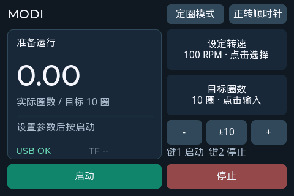
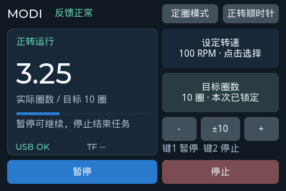
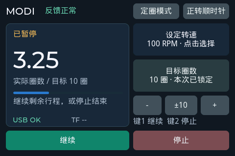

# MODI 总线电机控制与人机交互软件 v1.0 使用说明书

## 运行环境

ESP32-S3-WROOM-1U N16R8，M0603A 总线电机，480×320 横屏 LCD 与 FT6336U 触摸。
电机 UART1 为 38400 bps、8N1；实体启动键 GPIO12，停止键 GPIO15。
使用 U 盘记录运行日志，TF 卡另有挂载状态及读写支持。

## 页面与参数

准备页面显示原始电机位置和角度；运行后大数字显示相对本次起点的实际完成圈数。
上电角度不视为机械绝对零点，无需手动将角度调整到零。
RPM 表示设定转速。运行和暂停期间可以调整转速，本次任务的模式、方向和目标保持锁定。
圈数保留两位小数，超调读数不会裁剪为目标值。

## 自由运行

1. 在准备状态选择自由模式、方向和转速。
2. 点击启动或按 GPIO12；软件使能电机、读取起点，低速起步后平滑加速。
3. 点击暂停或再按 GPIO12，电机立即刹车，保留任务与起点。
4. 点击继续或再按 GPIO12，从低速平滑恢复。
5. 点击停止或按 GPIO15，立即刹车并结束运动。

## 指定圈数运行

1. 选择定圈模式，输入 1–9999 整数圈，或通过 ±1/±10 调整。
2. 选择方向与转速并启动，软件以本次读取位置为起点。
3. 接近目标时自动减速，最终读数显示实际完成圈数。
4. 若最终误差超过 ±0.5 圈，界面提示超差，不自动反向纠偏。

## 新运行和回位

完成或手动停止后，选择新运行进入准备状态并释放电机，再次启动才读取新起点。
选择回位立即按当前设定转速向保留起点运动，接近起点时减速，圈数逐渐降至零。
回位途中手动停止仍保留起点，可继续回位或选择新运行。
暂停保留任务，暂停后停止则结束本次运动。

## 日志与异常

插入可挂载的 U 盘后，运行数据追加到 LOGS/MOTOR.CSV，已有记录不会因重新启动而清空。
timestamp_ms 是设备启动后的毫秒数，跨重启追加时可能回到较小值。
motor_rpm 是设定转速；feedback_valid 为本次计圈反馈是否有效，不能单独判断为串口故障。
读取失败或跨圈关系暂时无法确定时保留上次圈数，后续可判定反馈再恢复。
起点读取失败时保持准备状态。运行中不配置失联自动停止，操作者可使用停止键结束运动。
日志写入错误由串口 USB_LOG/MSC_DRIVER 输出。

## 验收操作

从不同初始角度，分别执行 1、10、100 圈，覆盖五档转速和两个方向；
用独立机械标记核对实际圈数与最终误差，并检查暂停继续、手动停止和回位途中停止。
软件回放和模拟结果见版本记录，机械误差需在实际装配与负载下确认。

## 界面示例

以下为同一代码生成的 LVGL 主机渲染图，非实机照片。

